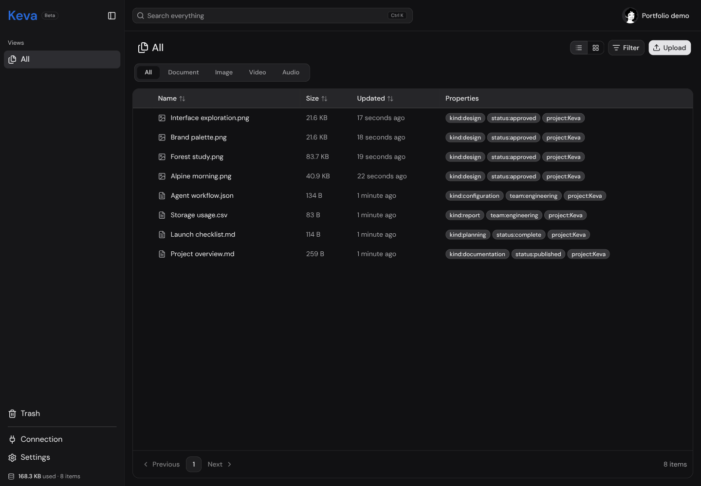
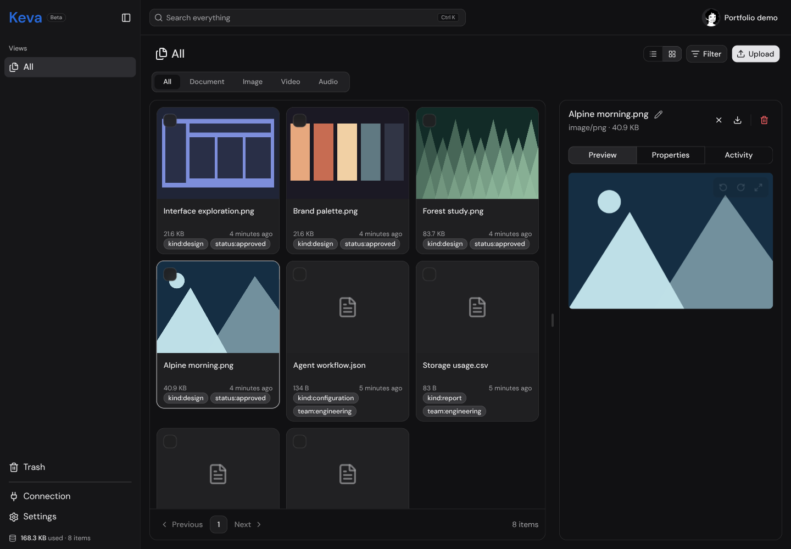
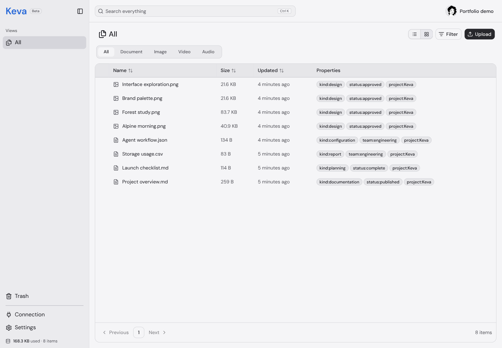
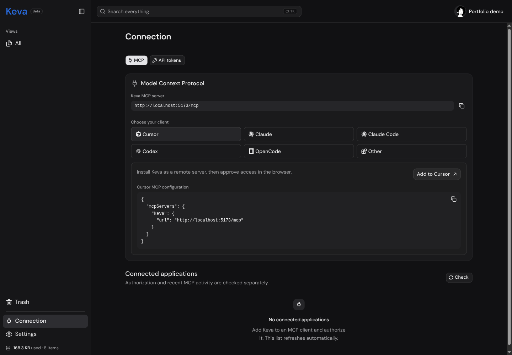
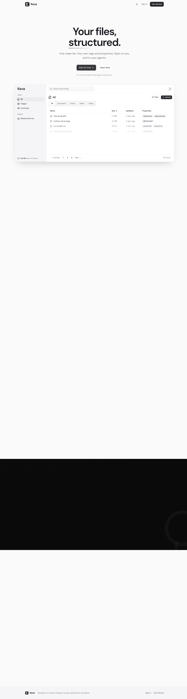

# Keva portfolio archive

Keva is no longer maintained. The source and these screenshots are preserved as a portfolio project.

[Project page](https://jawdoes.dev/projects/keva/)

## About the screenshots

The app ran locally for these captures. A separate demo account contains sample documents, structured data, and generated illustrations. No personal files, customer records, API tokens, or production data are shown. The developer inspection toolbar was hidden for capture. The landing page came from the existing local build.

These are screenshots of the working interface, not a hosted demo. The original Beta labels remain part of that interface.

## File library

## Metadata list

## File preview

## Light appearance

## MCP connections

## Original landing page

